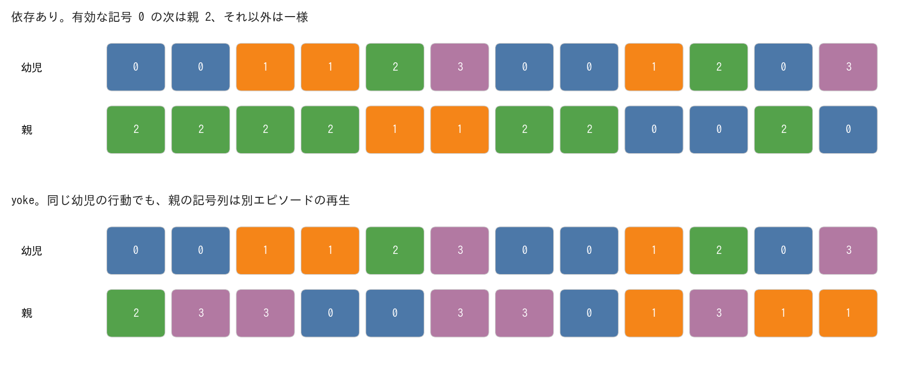
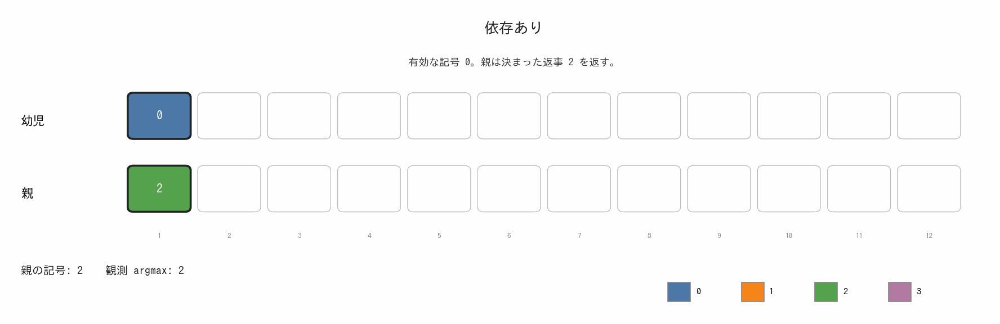

# コミュニケーション環境

`CommunicationEnv` は、幼児の信号の次で親が予測しやすくなるかを見るための離散環境です。学習するエージェントは置きません。呼び出し側が `reset` / `step` します。報酬は常に 0 です。

正本のコードは `envs/communication.py`、確認は `tests/test_communication.py` です。動きの録画は `demo/communication_demo.gif`、全体の並びは `demo/communication_timeline.png` です。

## 何が見えるか

幼児は毎 step、信号を 1 つ出します。信号は 4 種類です。何もしないは置きません。エネルギーも置きません。

`step(a)` が返す観測は、その行動 `a` への親の信号です。観察は親の信号だけです。自分の信号は観察に戻しません。選んだ行動は、世界モデルへ行動として渡ります。

ターンテーキングは扱いません。同じ観測を見ながら次に選ぶ行動は、その次の親の信号を決めます。

比べる条件は 2 つです。

- 依存あり。下の規則で親が返事をする。
- yoke。別エピソードで記録した親の記号列を、いまの幼児の行動と無関係に再生する。

## 呼び出し

```python
from envs.communication import CommunicationEnv

env = CommunicationEnv(max_steps=100, n_meaningful=1, dependency="short", obs_noise=0.0, seed=0)
obs, info = env.reset()
obs, reward, terminated, truncated, info = env.step(action)
```

`reward` は常に 0、`terminated` は常に False です。`max_steps` に達すると `truncated` が True になり、そのあとの `step` はエラーです。

行動番号は次のとおりです。

| 行動 | 意味 |
| --- | --- |
| 0 | 記号 0 |
| 1 | 記号 1 |
| 2 | 記号 2 |
| 3 | 記号 3 |

## 短期依存（`dependency="short"`）

既定です。対応は次の 4 組です。`n_meaningful`（1 以上 4 以下、既定 1）で表の先頭からその個数だけが有効です。エピソードを通して固定します。

| 番号 | トリガ | 返事 |
| --- | --- | --- |
| 0 | 0 | 2 |
| 1 | 1 | 3 |
| 2 | 2 | 0 |
| 3 | 3 | 1 |

既定の 1 では 0 番だけが有効です。無効な記号の次は、4 記号を一様独立に出します。返事と同じ記号も確率 1/4 で出ます。この対応は seed で変わりません。

## 長期依存（`dependency="long"`）

同じ行動空間と観察のまま、次の 2 本の鎖を扱います。`n_meaningful` はこのモードでは使いません。

- `0 → 親1 → 2 → 親3`
- `1 → 親0 → 3 → 親2`

位相は 3 つです。エピソード開始時は鎖の外です。位相は観測に入れません。自分の行動列だけで更新し、親が返した記号では更新しません。

鎖の外。

- `0` の次は親 `1`。位相は A の途中になる。
- `1` の次は親 `0`。位相は B の途中になる。
- `2` と `3` の次は 4 記号の一様。位相は鎖の外のまま。

途中は 1 手だけです。続きが合っていても外れていても、その 1 手のあと鎖の外に戻ります。戻ったあとの `0` や `1` は、新しい鎖の開始になります。途中の `0` や `1` では、新しい鎖は始まりません。

- A の途中。`2` の次は親 `3`。`0`，`1`，`3` の次は一様。
- B の途中。`3` の次は親 `2`。`0`，`1`，`2` の次は一様。

毎 step の予測誤差が 0 になる列は、鎖の外では `0` か `1`、A の途中では `2`、B の途中では `3` だけを出す列です。`0, 2` の繰り返し、`1, 3` の繰り返し、およびそのつなぎ合わせがこれに当たります。開始だけを繰り返す列は、1 手おきに一様になります。

## 観測

長さ 4 のベクトルです。親の信号の one-hot です。

| 位置 | 中身 |
| --- | --- |
| 0–3 | 親の記号の one-hot |

`obs_noise` は、この 4 成分に足すガウスノイズの標準偏差です。既定は 0 です。`reset` も `step` も同じです。テストは 0 で行います。

`reset` の観測は、直前の行動が無いので 4 記号から一様です。この記号は yoke の列に含めません。

世界モデルは、渡した行動から、その `step` が返す親の信号を予測します。

## info

| キー | 中身 |
| --- | --- |
| `parent_symbol` | クリーンな親記号（0–3）。観測がノイズで揺れても、列の記録とテストはこちらを見る |
| `dependency` | `"short"` または `"long"` |
| `phase` | `"outside"`、`"mid_a"`、または `"mid_b"`。短期でも返すが、長期でのみ意味がある |
| `yoke` | 再生中なら True |
| `n_meaningful` | コンストラクタに渡した値 |

## yoke

```python
tape = np.array([info["parent_symbol"] for ...], dtype=np.int64)  # shape (max_steps,)
obs, info = env.reset(options={"yoke_parent_symbols": tape})
```

yoke は別エピソードのクリーンな親記号列を再生します。形は `(max_steps,)`、値は 0–3 です。各 `step` がその 1 個を one-hot にし、そのエピソードの `obs_noise` を新たに足します。呼び出し側は各 `step` の `info["parent_symbol"]` を順に集めて列にします。

再生中は、いまの行動でも位相でも次の記号は決まりません。列に時系列の構造が残っていても、それはいまの行動では変わりません。`reset` の記号は列に含めません。

形が `(max_steps,)` でない、または値が 0–3 の外なら `reset` が `ValueError` を出します。

## デモの作り直し

`subtasks_for_cueworld` で次を実行すると、GIF と静止画を上書きします。

```bash
python demo/render_communication_demo.py
```



前半は依存ありです。有効な記号の次は決まった親の信号になり、無効な記号の次はばらばらです。



後半は、別エピソードの親記号列を yoke で再生します。幼児の行動列は前半と同じです。行動に依存した返事は来ません。
